# Cloudie architecture (INCYDE CPU model v0.1)

## What it does

The model takes one INSAT-3D/3DR infrared satellite image of a cyclone
(an INCYDE crop) and estimates two things:

1. **Maximum sustained wind** in knots (IMD 3-minute standard).
2. **Intensity category** in this project's IMD-style bins: `D_DD`, `CS`,
   `SCS`, `VSCS`, `ESCS_SUCS` (not official IMD classes).

It is evaluated only on storms it never saw in training (storm-ID split and
storm-grouped cross-validation). The results are validation-only research
numbers, not an operational forecast or warning.

Headline numbers: **TBD, filled in from the final run.**

This page describes the stack exactly as it is in the code on branch
`bean/incyde-cpu-model-v0.1`: `src/model.py`, `src/train.py` (`build_net`,
`EarlyStopping`, `load_init_weights`), `scripts/incyde_cpu/*.py` and
`config/incyde_cpu.yaml`. Values marked **TBD** are still being decided by
the runs logged in [`MODEL_CHANGELOG.md`](MODEL_CHANGELOG.md) and will be filled in from
the final run manifest. Everything here is validation-only research, not an
operational forecast.

## 1. Inputs and channels

- **One channel, infrared only.** INCYDE frames are INSAT-3D/3DR IR crops
  (grayscale JPEG, bright = cold cloud). TCIR pretraining uses IR1 only
  (GridSat-B1 brightness temperature in kelvin, sign-inverted so cold is
  bright like INCYDE). There is **no visible, water-vapour or microwave
  channel** and no multi-stream input. `model.channels: 1`.
- **Image size 96 x 96.** Each frame goes through main's
  `src.preprocessing.prepare_image` (median fill of missing pixels, bilinear
  resize of the whole crop to 96 x 96). INCYDE crops are roughly 400 x 436 px
  and TCIR frames 201 x 201 px; both are resized, not cropped.
- **Normalization:** z-score with one mean and std per dataset, fit on that
  run's training storms only (the per-dataset rule from #34). INCYDE fine-tuning
  refits INCYDE stats instead of reusing TCIR's. The stats are stored in the
  checkpoint (`norm_mean`, `norm_std`).
- **Circle mask:** when `augment.masked_rotation` is on, every input (train,
  validation and inference) is multiplied by a disc mask of diameter 96 px,
  so rotated and unrotated frames look the same outside the disc.
  Recorded as `circle_mask` in the checkpoint.

## 2. Backbones

### SimpleCNN (used in v0.1)

`src.model.SimpleCNN`, wrapped by `src.train.build_net`. 23,686 parameters.

| # | Layer | Output shape (batch B) | Params |
|---|---|---|---|
| 0 | input, z-scored, optional circle mask | B x 1 x 96 x 96 | 0 |
| 1 | Conv2d 1→16, 3x3, pad 1 + ReLU | B x 16 x 96 x 96 | 160 |
| 2 | MaxPool 2x2 | B x 16 x 48 x 48 | 0 |
| 3 | Conv2d 16→32, 3x3, pad 1 + ReLU | B x 32 x 48 x 48 | 4,640 |
| 4 | MaxPool 2x2 | B x 32 x 24 x 24 | 0 |
| 5 | Conv2d 32→64, 3x3, pad 1 + ReLU | B x 64 x 24 x 24 | 18,496 |
| 6 | AdaptiveAvgPool2d(1) + flatten | B x 64 | 0 |
| 7a | Wind head: Dropout(0.3) → Linear 64→1 | B x 1 (knots) | 65 |
| 7b | Category head: Linear 64→5 | B x 5 (logits) | 325 |

### ResNet-18 (in the code, not used in v0.1, pending Liora)

`src.model.ResNetRegressor`: torchvision ResNet-18 with `avgpool` replaced by
`AdaptiveAvgPool2d(1)`, `fc` removed (512-d features), the 1-channel IR
frame repeated to 3 channels so the 3-channel `conv1` is kept, wind head
Dropout → Linear 512→1, and the same 5-way category head. ImageNet weights
are off by default (`pretrained: false`; a download needs
`CLOUDIE_ALLOW_PRETRAINED=1`). It is **pending Liora's Intel Arc GPU**, which
waits for Anlea's driver update (32.0.101.8991 now, 32.0.101.9033 required)
and a passing parity test. A four-frame `ConvLSTMRegressor` also exists in
`src/model.py`; it is gated and not trained here.

## 3. Full model

```mermaid
flowchart LR
    A["IR frame (INCYDE JPEG or TCIR IR1 K, sign-inverted)"] --> B["prepare_image: median fill, resize 96x96"]
    B --> C["z-score with per-dataset train-storm mean/std"]
    C --> D["x circle mask (when masked rotation is on)"]
    D --> E["Conv 1-16 + ReLU, MaxPool"]
    E --> F["Conv 16-32 + ReLU, MaxPool"]
    F --> G["Conv 32-64 + ReLU"]
    G --> H["AdaptiveAvgPool -> 64-d feature"]
    H --> I["Dropout 0.3 -> Linear 64-1: wind (kt, IMD 3-min)"]
    H --> J["Linear 64-5: category logits"]
    I --> K["Smooth L1 loss"]
    J --> L["Cross-entropy (labelled rows only)"]
    K --> M["loss = SmoothL1 + w_cls x CE"]
    L --> M
```

- **Loss:** `SmoothL1(wind_pred, wind_true) + class_loss_weight x CE(logits, class)`.
  Rows below 17 kt have no class and add no CE term. `class_loss_weight` is
  0.5 in `config/incyde_cpu.yaml`; the final value is **TBD** from the
  ablations (E0 trains wind only, like main's `_fit_run`). Optional
  inverse-frequency class weights come from main's `class_sample_weights`
  (`train.class_weighting`, **TBD**).
- **Category scheme:** main's project bins from `src/schema.py`
  (`wind_to_imd5`): `D_DD` [17, 34) kt, `CS` [34, 48), `SCS` [48, 64),
  `VSCS` [64, 91), `ESCS_SUCS` ≥ 91 kt, on IMD 3-minute winds. These are
  IMD-style groupings, **not official IMD classes** (IMD splits D/DD and
  ESCS/SuCS, and its ESCS edge is 90 kt) and **not Saffir-Simpson**. The
  code has no Saffir-Simpson mapping.
- **Two ways to read a category**, both scored: the class head's argmax, and
  the predicted wind binned with the same edges. Which one is reported as
  the headline is **TBD** (picked on validation macro-F1).

## 4. Data pipeline

### INCYDE (fine-tune and evaluation)

- Source: INCYDE cropped set, Zenodo [10.5281/zenodo.8015544](https://doi.org/10.5281/zenodo.8015544),
  CC BY 4.0, zip md5 `ed5dac254c689e5a327dee7580324347`. 103,368 JPEGs:
  21,313 originals + 82,055 augmented copies, 91 storms (2013–2021), North
  Indian Ocean. Labels are IMD best-track 3-minute winds (kt), used unchanged.
- **Exclusions:** `incyde/audit/exclusions.csv`; only `default_exclude=true`
  rows are dropped: 438 rows (73 Sequence-42 originals with IMD day/month
  swapped, plus their 365 copies). Flag-only rows (`label_ne_imd_interp`,
  `outside_imd_track_span`) are kept.
- **Kept after prep:** 21,240 originals and 16,338 INCYDE `rot_180` copies.
  INCYDE's `flip_h`, `flip_v`, `rot_90`, `rot_270` copies are not used.
- **Split:** `incyde/audit/storm_split.csv`, by storm ID, with every
  `cooccurrence_group` (storms sharing a scene/timestamp) kept in one split:
  60 train / 14 val / 17 test storms. No storm, frame or timestamp crosses
  splits; a pHash check found no near-duplicates. `year_holdout_2019` is off.
  **Test storms are sealed** in v0.1: never loaded for training, model
  selection or reporting.
- **Augmentation (train only, on the fly):** each training frame is used as
  is, as `rot_180` (INCYDE's own copy of that frame when it exists, else a
  180° `rot90`), or rotated by a random angle under the circle mask, with
  equal probability. **No flips.** A `rot_180` copy always sits in its
  original's split and CV fold.

### TCIR (pretraining)

- TCIR IR1 (`src.tcir` reader and IR1 gate): 69,867 frames kept, 632 excluded,
  1,285 storms, six basins. Split storm-wise with main's
  `src.splits.assign_storms` (seed 42, 10% val, 10% test).
- **Label conversion:** TCIR `Vmax` is a 1-minute wind. Every row keeps
  `wind_kt_raw` and `wind_averaging_s = 60`; the target is
  `wind_kt_3min = 0.93 x wind_kt_raw`, one config value
  (`labels.one_to_three_min_factor`). 0.93 is **derived** from WMO/TD-1555
  (Harper, Kepert & Ginger 2010) Tables 1.1 and 1.2, at-sea exposure; it is
  not a WMO constant and is pending Researchy's verification.
- **Near land:** 5,764 rows whose centre is within ~20 km of land
  (approximate, `global-land-mask` sampled on rings) are flagged `near_land`
  and left out of the converted run rather than converted with an at-sea factor.
- A second pretraining run uses the raw 1-minute labels so the effect of the
  conversion can be measured.
- **NASA TC imagery is not on the box,** so NASA is not used in v0.1.

## 5. Training setup

| Setting | Value (config/incyde_cpu.yaml) |
|---|---|
| Optimizer | AdamW, lr 1e-3, weight decay 1e-4 |
| LR schedule | constant (cosine is an option under test: **TBD**) |
| Batch size | 64 |
| Epochs | up to 30, early stopping on validation wind MAE, patience 6 (main's `EarlyStopping`); best epoch's weights kept |
| Wind-head bias init | train mean (option under test: **TBD**) |
| Seed | 42 (CV fold k uses 42 + k) |
| Pretrain → fine-tune | `--init-from` loads weights only (main's `load_init_weights`, architecture check), INCYDE normalization refit, fresh optimizer |
| Checkpoints | every epoch (`epoch_XX.pt`) plus `checkpoint.pt` and `run_manifest.json` (git SHA, data hashes, seeds, config, wall time, hardware) |
| Device | `train.device: auto` → xpu, then cuda, then cpu (`src.device`; GPU needs `CLOUDIE_ALLOW_GPU=1`) |
| Hardware, v0.1 | shared box CPU: 8 vCPU, fp32, torch 2.14.1+cpu. About 12–20 s per INCYDE epoch |
| Hardware, later | Liora Intel Arc GPU (native XPU, bf16 when native) — **pending driver update** |

## 6. Evaluation

- **Wind:** MAE, RMSE and bias in kt (`src.metrics.regression_metrics`), a
  storm-level bootstrap interval (1,000 resamples of storms,
  `storm_bootstrap_metrics`), and error by true category (`metrics_by_class`).
- **Category:** accuracy, macro-F1 over classes present, per-class recall
  (`classification_metrics`) and a confusion matrix, for the class head and
  for binned wind.
- **Protocol:**
  1. Fixed split: train storms → validation storms (early stopping uses val MAE).
  2. Storm-grouped 5-fold CV over train + val storms: folds are whole
     `cooccurrence_group`s balanced by frame count, each fold trained for
     the fixed split's best epoch count (no early stopping on the fold).
     Reported as mean ± std over folds. CV is how ESCS/SuCS frames get
     scored, since val has no SuCS.
  3. Test storms: sealed.
- **Baselines** (fit on the training rows of the same split/fold): predict
  the train-mean wind; predict the majority category.
- **Reporting:** validation and CV only, never presented as a forecast or as
  operational skill. Only about 9% of INCYDE labels sit on a real IMD fix;
  the rest are interpolated, so agreement with labels is not ground truth.
